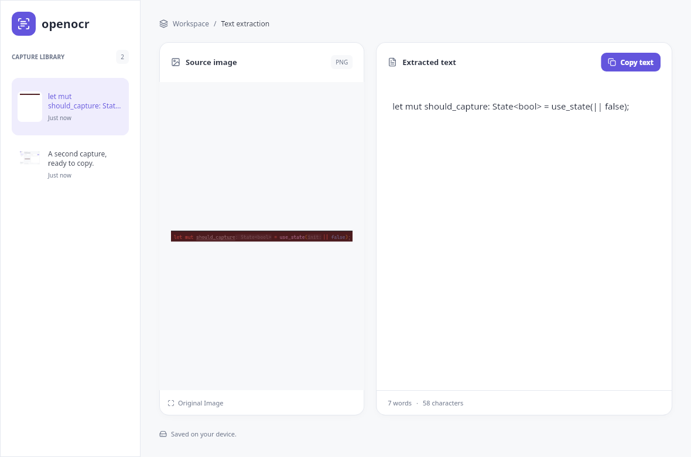

# openocr

A lightweight desktop OCR tool built with Rust. Select any region of your screen, and openocr captures it, sends it to a local LLM via [LM Studio](https://lmstudio.ai/), and returns the extracted text -- all running locally on your machine.

Built with [Freya 0.5.0](https://github.com/marc2332/freya), a native Rust GUI framework powered by Skia and winit.



## Workspace

- Light surfaces, indigo accents, and readable typography
- A capture library with thumbnails, text previews, relative timestamps, and an active selection
- Side-by-side source and text cards that stack in smaller windows
- Selectable text, one-click copying with confirmation, and word/character counts
- A guided capture overlay with an unobstructed selection, reading status, and visible errors

Screenshots and history stay in `~/.openocr/`. Images are sent to the API endpoint you configure, which defaults to local LM Studio.

Open previous captures with `openocr --history`, without taking a screenshot or contacting the OCR server. The newest saved capture is selected automatically. Saved text remains available if its source image has been deleted.

## How It Works

1. **Launch** -- openocr creates a transparent fullscreen overlay on each connected monitor
2. **Select** -- click and drag to draw a selection rectangle over the text you want to extract
3. **Extract** -- the selected region is captured, cropped, and sent to a vision-capable LLM running in LM Studio
4. **Result** -- a new window appears with the extracted text and the captured screenshot, plus a button to copy the text to your clipboard
5. **Exit** -- press `ESC` at any time to quit

## Prerequisites

- **Rust 1.97.1 or newer** (edition 2024) -- install via [rustup](https://rustup.rs/)
- **LM Studio** running locally with a vision-capable model loaded (default: `allenai/olmocr-2-7b`)
- **Linux** with X11 (screen capture uses `xcap`)

## Installation

```sh
git clone https://github.com/aspnxdd/openocr.git
cd openocr
cargo build --release
```

## Usage

Make sure LM Studio is running with a vision model loaded, then:

```sh
# Run with defaults
cargo run --release

# Specify a different model
cargo run --release -- --model "your-model-name"

# Use a different API endpoint
cargo run --release -- --url "http://localhost:8080/v1"

# Disable screenshot display in the result window
cargo run --release -- --display-screenshot false

# Browse saved captures without screen capture or an OCR server
cargo run --release -- --history

# Allow a slower local model up to five minutes per request
cargo run --release -- --timeout 300
```

### CLI Options

| Flag                   | Short | Default                    | Description                                       |
| ---------------------- | ----- | -------------------------- | ------------------------------------------------- |
| `--model`              | `-m`  | `allenai/olmocr-2-7b`      | LLM model name for OCR                            |
| `--url`                | `-u`  | `http://localhost:1234/v1` | OpenAI-compatible API base URL                    |
| `--display-screenshot` | `-d`  | `true`                     | Show the captured screenshot in the result window |
| `--history`            |       | `false`                    | Open the saved capture library instead of capture overlays |
| `--timeout`            |       | `120`                      | OCR request deadline in seconds; must be greater than zero |

History mode opens only the workspace; launch without `--history` to take a new capture. It still requires a graphical desktop, but does not enumerate or capture monitors.

### Reliability and recovery

- Requests that exceed `--timeout` show an error and allow another selection. Increase the deadline for slow models; requests are not retried automatically.
- History saves run off the UI thread, serialize writers with `~/.openocr/history.lock`, write the PNG first, then atomically replace the JSON index. Existing history is not overwritten if it cannot be read or parsed. New screenshots and index files are owner-only (`0600`) on Unix; existing screenshot permissions are not changed.
- A history load or save failure is shown in the UI. Extracted text remains available for copying when saving fails. If `history.json` is corrupt, back it up before repairing it; the app does not automatically reset it.
- Atomic replacement protects against partial index writes, not every power-loss scenario. An interrupted save can leave an unlisted image in `~/.openocr/screenshots/`.

## Key Dependencies

| Crate                                         | Role                                   |
| --------------------------------------------- | -------------------------------------- |
| [freya](https://github.com/marc2332/freya)    | GUI framework (Skia + winit)           |
| [xcap](https://crates.io/crates/xcap)         | Screen capture and monitor enumeration |
| [rig-core](https://crates.io/crates/rig-core) | LLM client (OpenAI-compatible API)     |
| [image](https://crates.io/crates/image)       | Image cropping                         |
| [clap](https://crates.io/crates/clap)         | CLI argument parsing                   |
| [tokio](https://crates.io/crates/tokio)       | Async runtime                          |

## Development

```sh
# Format Rust and TOML files
just f

# Build in debug mode
cargo build

# Run in debug mode
cargo run

# Filesystem, mock OCR server, CLI, and headless UI tests
cargo test --locked

# Check the optional developer-tools integration
cargo check --locked --features devtools
```

UI tests render wide, compact, and text-only previews to `target/workspace-*.png` without launching a desktop window. The `--display-screenshot false` option also hides source images when browsing history. Persistence tests use isolated temporary directories, and OCR tests use a local mock server; neither touches your saved history nor requires LM Studio.

## License

MIT
